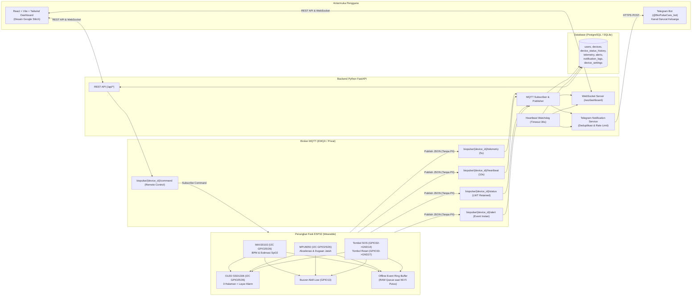

# BioPulse Care — Dokumentasi Arsitektur Sistem

Dokumen ini menjelaskan arsitektur teknis end-to-end **BioPulse Care** sesuai dengan `BioPulse_Care_Antigravity_Website_Guide.md`, mencakup perangkat fisik ESP32, protokol MQTT (LWT & Heartbeat), backend FastAPI, database PostgreSQL (dengan fallback SQLite untuk pengujian lokal tanpa instalasi server DB), integrasi Telegram Bot, dan dashboard web React.

---

## 1. Diagram Alur Arsitektur

---

## 2. Spesifikasi Hardware & Wiring Aktual ESP32

Firmware berada di `firmware/BioPulse/BioPulse.ino` dan **mempertahankan 100% wiring fisik aktual**:

| Komponen | Pin ESP32 | Konfigurasi & Catatan |
| :--- | :--- | :--- |
| **Bus I²C SDA** (OLED, MPU6050, MAX30102) | `GPIO 25` | `Wire.begin(25, 26, 100000)` |
| **Bus I²C SCL** (OLED, MPU6050, MAX30102) | `GPIO 26` | Clock 100 kHz, timeout 50 ms |
| **Tombol SOS (Input)** | `GPIO 32` | `INPUT_PULLUP` (Tekan tahan $\ge 2000\text{ ms}$ = SOS; tekan singkat $< 800\text{ ms}$ = ganti halaman OLED) |
| **Tombol SOS (Virtual GND)** | `GPIO 14` | `OUTPUT`, `LOW` |
| **Tombol Reset (Input)** | `GPIO 33` | `INPUT_PULLUP` (Mematikan alarm SOS, dugaan jatuh, dan buzzer jarak jauh) |
| **Tombol Reset (Virtual GND)** | `GPIO 27` | `OUTPUT`, `LOW` |
| **Buzzer** | `GPIO 13` | `BUZZER_PASIF = 0`, `BUZZER_ACTIVE_LOW = 1`, `GPIO_DRIVE_CAP_3` |

### Prinsip Keselamatan Offline (Offline-First Safety)
- Seluruh pembacaan sensor (`MAX30102`, `MPU6050`), pembaruan layar `OLED`, deteksi aturan lokal (`accMagnitude > 22.0 m/s²`), tombol `SOS`, tombol `Reset`, dan `Buzzer` dieksekusi di `loop()` utama **tanpa pemanggilan fungsi jaringan yang bersifat blocking**.
- Saat Wi-Fi atau broker MQTT terputus:
  1. Perangkat tetap mendeteksi dugaan jatuh dan tombol SOS serta membunyikan buzzer lokal.
  2. Kejadian penting disimpan di dalam `OfflineEventQueue` (buffer melingkar di RAM hingga 10 kejadian beserta waktu terjadinya).
  3. Percobaan sambung ulang Wi-Fi (`10 detik`) dan MQTT (`5 detik`) dilakukan secara asinkron/non-blocking.
  4. Saat koneksi pulih, perangkat mengirim status `online` (retained) dan mengunggah seluruh kejadian yang tersimpan di buffer.

---

## 3. Protokol MQTT, Topik, Heartbeat, dan LWT

### 3.1 Struktur Topik (Tanpa Identitas Pribadi / PII)
Seluruh topik menggunakan `device_id` (default: `bp-device-001`):

| Topik | Arah | Interval / Pemicu | Retain | Deskripsi |
| :--- | :--- | :--- | :--- | :--- |
| `biopulse/{device_id}/telemetry` | ESP32 $\to$ Backend | Setiap **5 detik** | `false` | Data BPM, SpO₂, status jari, akselerasi X/Y/Z, gyro, magnitudo, status sensor |
| `biopulse/{device_id}/heartbeat` | ESP32 $\to$ Backend | Setiap **10 detik** | `false` | Status hidup perangkat, uptime, RSSI Wi-Fi, sisa heap, kesehatan modul I²C |
| `biopulse/{device_id}/status` | ESP32 / Broker $\to$ Backend | Saat konek & LWT | `true` | Status `online` saat terhubung; pesan Will `offline` otomatis dari broker jika terputus tidak normal |
| `biopulse/{device_id}/alert` | ESP32 $\to$ Backend | Instan saat event | `false` | Peringatan awal: `SOS_MANUAL`, `FALL_CANDIDATE`, `SENSOR_ERROR`, `ALARM_RESET` |
| `biopulse/{device_id}/command` | Backend $\to$ ESP32 | Saat tombol web ditekan | `false` | Perintah jarak jauh: `buzzer`, `voice_ping`, `reset_alarm`, `test_sos` |

### 3.2 Mekanisme Ganda Deteksi Offline (LWT + Heartbeat Watchdog)
1. **MQTT Last Will and Testament (LWT):** Saat ESP32 melakukan `mqtt.connect()`, perangkat mendaftarkan Will message pada topik `biopulse/{device_id}/status` dengan payload `{"device_id":"bp-device-001","status":"offline","reason":"lwt"}` (`retain=true`).
2. **Backend Heartbeat Watchdog (30 Detik):** Tugas latar belakang di backend memeriksa `last_heartbeat_at` seluruh perangkat setiap 5 detik. Jika tidak ada heartbeat maupun telemetry selama **> 30 detik**, perangkat ditandai `offline` (`reason="heartbeat_timeout"`), disimpan ke `device_status_history` & `alerts`, dikirim ke dashboard via WebSocket, dan memicu notifikasi Telegram.

---

## 4. Skema Database Multi-Device (PostgreSQL)

Skema lengkap didefinisikan pada `backend/schema.sql` dan `backend/app/models/models.py`:

1. **`users`**: Menyimpan akun caregiver/admin (`id`, `username`, `full_name`, `role_label`, `password_hash`, `telegram_chat_id`, `created_at`).
2. **`devices`**: Menyimpan daftar perangkat (`id`, `device_id` unik, `display_name`, `patient_name`, `status`, `battery_pct`, `rssi`, `oled_ok`, `max_ok`, `mpu_ok`, `finger_detected`, `sos_active`, `fall_candidate`, `last_seen_at`, `last_heartbeat_at`).
3. **`device_status_history`**: Riwayat transisi `online` / `offline` (`id`, `device_id`, `status`, `reason`, `recorded_at`).
4. **`telemetry`**: Data sensor berkala (`id`, `device_id`, `bpm`, `spo2`, `finger_detected`, `accel_x`, `accel_y`, `accel_z`, `accel_mag`, `gyro_x`, `gyro_y`, `gyro_z`, `sos_active`, `fall_candidate`, `device_timestamp`, `recorded_at`).
5. **`alerts`**: Log kejadian dan peringatan (`id`, `device_id`, `alert_type`, `category`, `urgency`, `title`, `description`, `detection_method`, `acknowledged`, `acknowledged_by`, `acknowledged_at`, `created_at`).
6. **`notification_logs`**: Riwayat pengiriman Telegram yang berelasi dengan `alerts` (`id`, `alert_id`, `device_id`, `channel`, `recipients_label`, `message_id_label`, `status`, `status_label`, `error_detail`, `sent_at`).
7. **`device_settings`**: Konfigurasi interval per perangkat (`device_id`, `telemetry_interval_sec`, `heartbeat_interval_sec`, `offline_timeout_sec`, `fall_threshold_ms2`).

---

## 5. Spesifikasi REST API & WebSocket

| Metode | Endpoint | Fungsi |
| :--- | :--- | :--- |
| `GET` | `/api/health` | Status kesehatan backend, koneksi database, dan broker MQTT |
| `GET` | `/api/devices` | Daftar seluruh perangkat terdaftar beserta status terkininya |
| `GET` | `/api/devices/{device_id}` | Detail perangkat dan konfigurasi ambang/interval |
| `GET` | `/api/devices/{device_id}/telemetry` | Data riwayat telemetri (dengan parameter `limit` & `offset`) untuk Grafik Tren Hari Ini |
| `GET` | `/api/devices/{device_id}/alerts` | Daftar riwayat event beserta status pengiriman Telegram (mendukung filter `category`, pencarian `q`, `limit`, `offset`) |
| `POST` | `/api/devices/{device_id}/alerts/{alert_id}/acknowledge` | Menandai event sebagai selesai/ditinjau oleh caregiver |
| `POST` | `/api/devices/{device_id}/command` | Mengirim perintah MQTT ke ESP32 (`buzzer`, `voice_ping`, `reset_alarm`, `test_sos`) |
| `POST` | `/api/notifications/test` | Mengirim pesan uji coba ke Telegram Bot (`@BioPulseCare_bot`) dan mencatat hasilnya ke tabel log |
| `GET` | `/api/dashboard/summary` | Payload gabungan untuk inisialisasi cepat halaman utama dashboard Stitch |
| `WS` | `/ws/dashboard` | Kanal WebSocket real-time untuk mendorong event `telemetry`, `device_status`, `alert`, dan `command_ack` ke React |

---

## 6. Keamanan & Privasi

- **Tidak Ada Secret di Kode Sumber:** Seluruh kredensial dibaca dari variabel lingkungan (`.env`), dengan contoh di `.env.example` dan pengecualian di `.gitignore`.
- **Perlindungan Privasi di Broker Publik:** Nama pasien (`Bpk. Soedirman`) dan keluarga (`Ibu Siti Rahayu`) hanya disimpan di database backend, tidak pernah dikirim lewat payload MQTT publik EMQX.
- **Query Terparameter & Header Keamanan:** Semua akses database menggunakan parameter terikat (`?` / ORM), serta dilengkapi `Content-Security-Policy`, `X-Content-Type-Options: nosniff`, `X-Frame-Options: DENY`, dan rate-limiting pada endpoint perintah/notifikasi.
